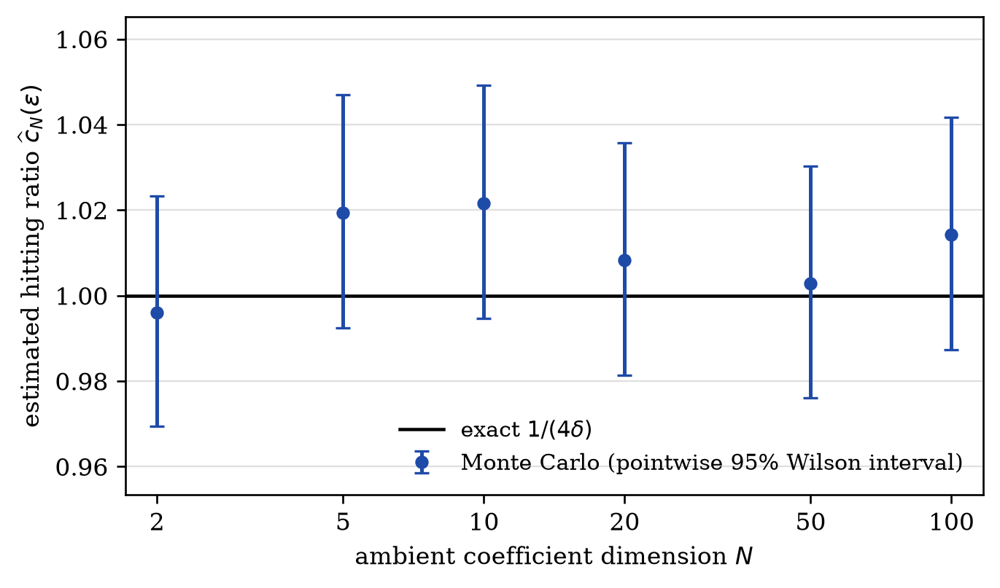
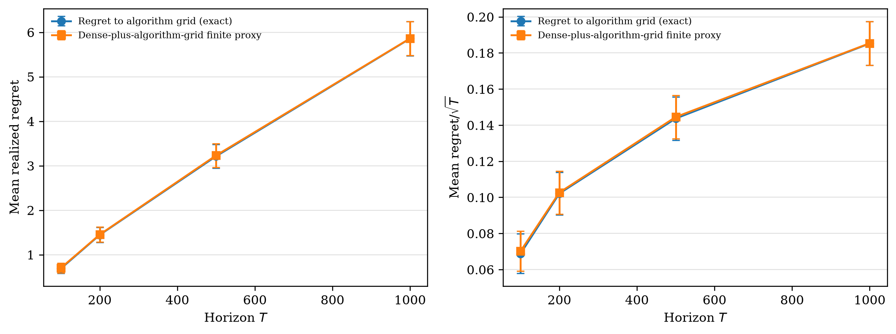
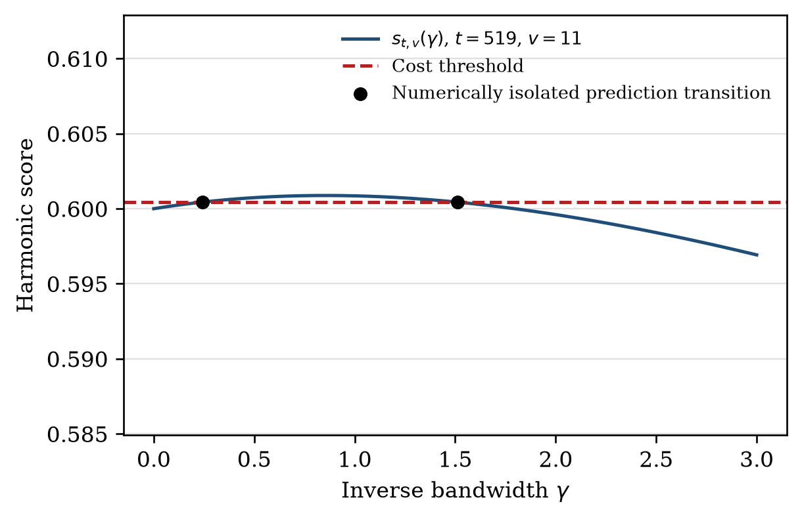
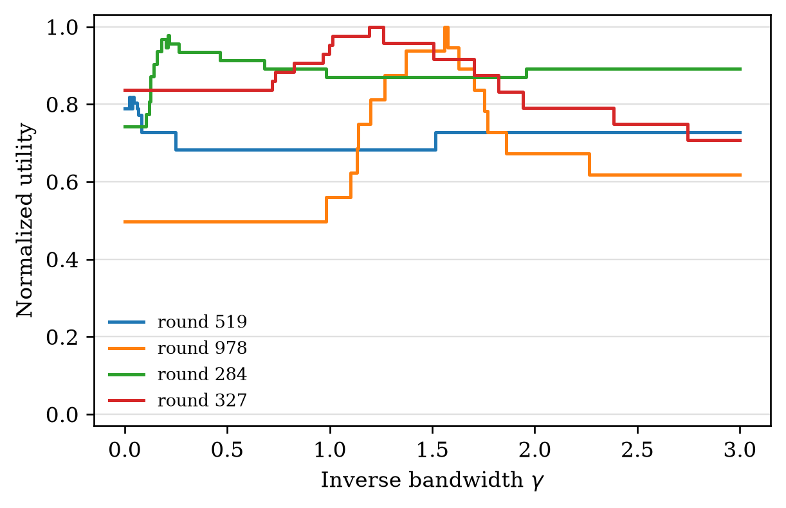
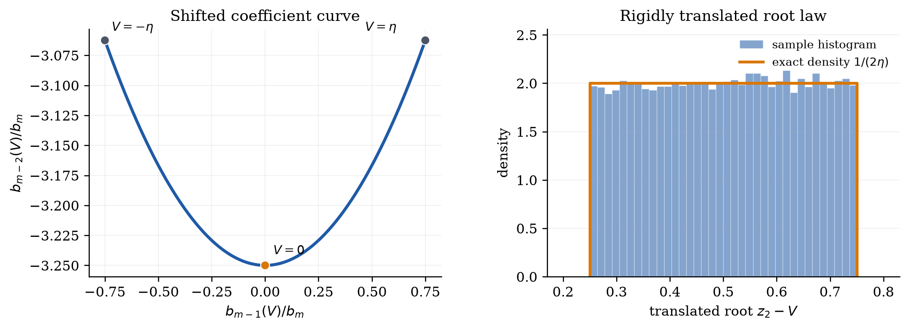

# Sharp Root Anti-Concentration

[](https://github.com/sgzizi/sharp-root-anticoncentration/actions/workflows/tests.yml) [](https://www.python.org/) [](LICENSE)

Reproducibility artifact for *Sharp Root Anti-Concentration via Projective Incidence and Ordered Root Laws* by Zijun Wang and Yuchen Miao. The paper's results are analytic; this repository provides executable identity checks and seeded illustrations of the geometric and learning-theoretic mechanisms.

**After the one-time setup below, one command reproduces every test, figure, and table:**

```bash
bash reproduce_all.sh
```

CPU only · Python 3.10+ · fixed seeds · about one minute on a recent laptop

## Quick start

```bash
python3 -m venv .venv
source .venv/bin/activate
python -m pip install -e ".[test]"
bash reproduce_all.sh
```

The script runs the complete test suite before regenerating the contents of [`figures/`](figures) and [`results/`](results). To run only the tests:

```bash
python -m pytest
```

## Artifact map

| Study | Paper connection | Run | Main outputs |
|---|---|---|---|
| Cube incidence | Dimension-free example, Equation (19) | `python experiments/dimension_free.py` | Hitting ratios, exact reference, Wilson intervals |
| Gaussian-RBF graph SSL | Equation (56), Theorem 5.1 | `python experiments/rbf_graph_ssl.py` | Transitions, utilities, online regret |
| Common-offset polynomial law | Mechanism used in Theorem 5.2 | `python experiments/common_offset_demo.py` | Coefficient curve, translated root law |
| Consistency checks | Analytic and online interfaces | `python -m pytest` | Incidence, derivatives, timing, root translation |

## Reference experiments

### 1. Dimension-free cube incidence

For the feature curve $F_{\delta,N}(x)=(1,x/\delta,0,\ldots,0)$ and coefficients drawn uniformly from the cube $[-1,1]^N$, the exact interval-hitting ratio is

$$
\frac{\Pr\{x_\alpha\in[-\varepsilon,\varepsilon]\}}{2\varepsilon}
=\frac{1}{4\delta},
\qquad 0<\varepsilon\leq\delta.
$$

Only the two active coordinates are sampled; integrating out the remaining coordinates leaves the root event unchanged. The experiment compares the exact dimension-free value with seeded Monte Carlo estimates and pointwise 95% Wilson intervals.

<p align="center">
  
</p>

### 2. Cost-sensitive Gaussian-RBF graph SSL

The RBF experiment instantiates the transition-to-regret pipeline. It solves the grounded harmonic systems directly, constructs the piecewise-constant cost-sensitive utilities, and runs full-information Hedge on the horizon-dependent parameter grid.

The regret panel separates two finite comparators: regret to the algorithm grid is exact, while the second curve uses the union of that grid with a dense evaluation grid. Error bars are pointwise normal-approximation 95% intervals over 30 independent cost/action repetitions, conditional on the fixed oblivious base-instance sequence.

<p align="center">
  
</p>

The transition and utility panels come from the same fixed maximum-horizon run. A deterministic rule selects an illustrative score curve; its selection metadata and the displayed rounds are recorded with the numerical outputs.

<p align="center">
  
  
</p>

### 3. Common-offset polynomial law

For a fixed polynomial $\psi$, the experiment verifies the identity $\psi_V(\lambda)=\psi(\lambda+V)$ before plotting. The shifted coefficient vectors trace a one-parameter polynomial curve, while every ordered real root undergoes the rigid translation $z_j\mapsto z_j-V$.

<p align="center">
  
</p>

## Validation and conventions

- **Exact checks.** The test suite covers the cube hitting identity, the cube-section incidence formula, harmonic-score derivatives, the online action/observation order, and polynomial root translation.
- **Online timing.** Utility matrices are precomputed by the oblivious environment and remain hidden from the learner. `act()` receives no utility input; the current utility row reaches `observe()` only after the action is fixed.
- **Numerics.** Grounded linear systems are solved directly. No matrix inverse or determinant expansion is evaluated numerically.
- **Randomness.** All generators use fixed, explicitly recorded seeds. Figures are saved in both PNG and vector PDF formats; tables and configuration metadata are saved as CSV files.

The full protocol, comparator definitions, figure-selection rules, and output inventory are documented in [`docs/REPRODUCIBILITY.md`](docs/REPRODUCIBILITY.md).

## Repository layout

```text
experiments/          figure and table generators
src/sharp_root_ac/    incidence, harmonic-extension, online-learning,
                      and polynomial-shift routines
tests/                equation- and protocol-level checks
figures/              generated PNG and vector PDF figures
results/              generated CSV summaries and metadata
docs/                 reproduction protocol and output inventory
```

## Citation

Citation metadata are provided in [`CITATION.cff`](CITATION.cff) and are also available through GitHub's **Cite this repository** menu.

## License

Released under the [MIT License](LICENSE).
